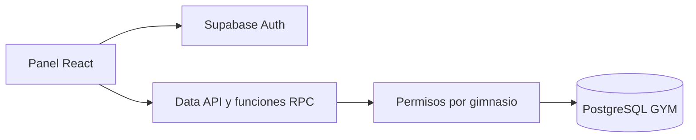

# Contexto

Aplicación SaaS para gestionar múltiples gimnasios con una sola base. Los clientes del gimnasio no tienen acceso al panel. Cada propietario controla sus gimnasios y colaboradores; no existe un superadministrador público.

## Arquitectura

React + TypeScript + Vite; cliente Supabase con clave pública, Auth para identidad y PostgreSQL/RLS para autorización. Operaciones financieras mediante funciones transaccionales de base de datos. Sin claves privilegiadas en frontend.
Destino único comprobado: proyecto GYM, cjmffrhnlsypasnijuhm, us-east-2; tablas públicas vacías al comenzar el 28 de octubre de 2026.

## Decisiones

- COP, centavos enteros y America/Bogota por defecto.
- Propietario inmutable en gimnasios; colaboradores asignados por propietario.
- Recepción opera POS y clientes; inventario mantiene productos y máquinas; instructores consultan clientes y su tarifa; propietario administra todo salvo modificar ventas cerradas.
- No eliminar historia financiera; clientes, productos y máquinas se archivan.
- Membresía activa si la fecha local es anterior al vencimiento; período inicial de 30 días.

## Estado

Implementado: landing pública, acceso por correo/contraseña, recuperación, selección de gimnasio según permisos, panel operativo y módulo Equipo con invitaciones por correo y rol.

La cuenta inicial y un gimnasio GYM se crearon por solicitud expresa del usuario. Las credenciales están solo en un archivo local ignorado por Git; no se documentan aquí datos personales. La cuenta requiere confirmar el correo.

Las invitaciones se guardan en staff_invitations. Solo el propietario puede crearlas o revocarlas. La función invite-staff comprueba el token con Auth y la propiedad del gimnasio antes de usar la API administrativa de correo. Al ingresar, accept_staff_invitations vincula exclusivamente invitaciones vigentes al correo confirmado de la cuenta. No se usa metadata editable para otorgar permisos.

Verificado: build, pruebas SQL de aislamiento, permisos, cierre idempotente, stock y ventas inmutables. Pruebas de interfaz y límites: ver [VERIFICACION.md](VERIFICACION.md). No se ha desplegado el frontend públicamente. La función invite-staff sí está desplegada en Supabase.

Pendiente: comprobar entrega real de invitaciones y configurar URLs de redirección de Auth/SMTP; completar worker y programación de recordatorios; personalizar nombre, datos y tarifas definitivas. La cola SQL de recordatorios existe, pero no envía correos.

Avisos del proveedor: protección contra contraseñas filtradas desactivada; private.reminder_jobs tiene RLS sin políticas de usuario intencionalmente (solo funciones de servicio). No equivale a una auditoría completa.
