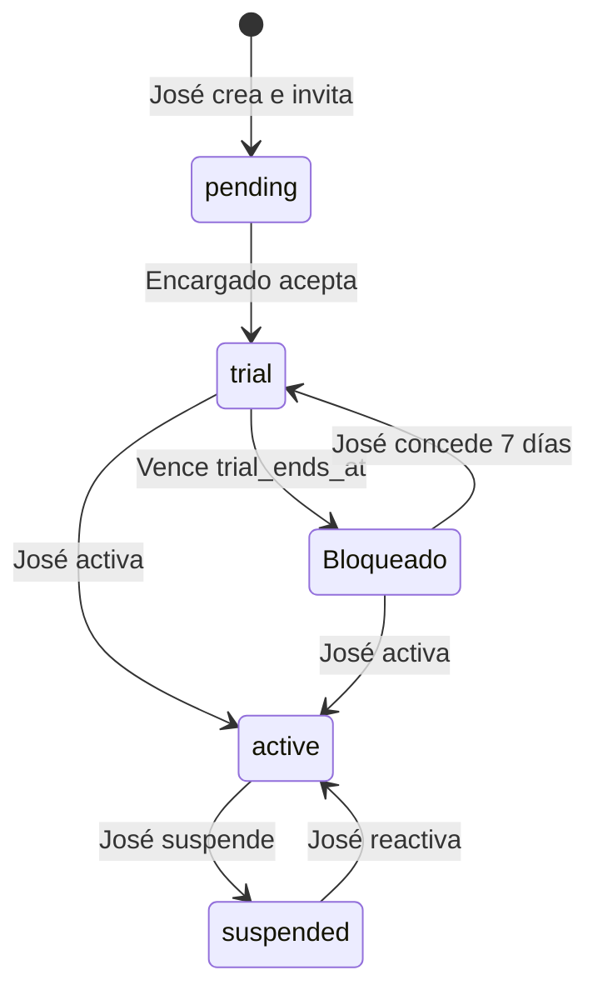

# Contexto

GYM es una plataforma para que José ofrezca pruebas de siete días a varios gimnasios. Una sola base Supabase atiende a todos; los clientes finales del gimnasio no acceden al panel.

## Arquitectura y destino

React + TypeScript + Vite; Supabase Auth para identidad y PostgreSQL/RLS para permisos. El frontend usa únicamente una clave pública. Las operaciones financieras y de plataforma usan funciones SQL transaccionales; no hay claves privilegiadas en el navegador.

Destino único: Supabase GYM, cjmffrhnlsypasnijuhm, us-east-2. Frontend publicado por el usuario en https://gymtuchin.vercel.app. Migraciones canónicas en supabase/migrations; no mantener snapshots SQL alternativos.

## Roles y pruebas

El rol global vive en private.platform_admins. La cuenta confirmada autorizada de José fue asignada expresamente como superadministradora en esta base; la asignación personal no se incluye como semilla en Git. Nuevos usuarios nunca reciben ese rol automáticamente.

José crea un gimnasio con estado pending e invita a un encargado. Al aceptar con su correo confirmado, el gimnasio cambia a trial, el destinatario se convierte en su encargado (owner_id), y empieza una semana de siete períodos de 24 horas. Reemplazar al encargado no reinicia la prueba.

Bloqueado es un estado calculado, no una fila duplicada: el acceso depende de lifecycle y trial_ends_at. El vencimiento se valida en RLS y en escrituras RPC; no necesita cron. El panel comprueba su límite cada 15 segundos. Los datos permanecen y solo José puede reactivar.

El encargado administra sus tarifas, clientes, ventas, finanzas y equipo. Los operarios venden, registran visitas/clientes y cobran membresías, sin archivar ni configurar tarifas. Inventario mantiene productos y máquinas sin retirar registros; instructores consultan clientes. Los archivados corresponden al encargado o José. Las ventas cerradas siempre son inmutables.

## Datos y reglas

Tablas: gyms, staff, clients, products, machines, sales, sale_items, memberships, cash_entries y staff_invitations. Privadas: platform_admins y reminder_jobs. Cada entidad operativa incluye gym_id; claves compuestas impiden referencias a otro gimnasio.

COP y America/Bogota. Importes en centavos enteros. Precio diario, precio de membresía y membership_days son configurables por gimnasio. La renovación anticipada conserva días pendientes. Los cambios afectan a ventas nuevas.

Las invitaciones distinguen manager y staff. Solo la plataforma crea invitaciones de encargado. El destinatario se verifica contra auth.users con correo confirmado, nunca metadata editable. invite-staff valida el token, el rol de plataforma o la propiedad del gimnasio y la vigencia antes de enviar correo.

## Acceso y recuperación

Site URL de Supabase: https://gymtuchin.vercel.app. Redirect URLs: https://gymtuchin.vercel.app/**. El conector no permite editar estos ajustes de Auth; se guardan en el dashboard. El usuario confirmó su correo.

El registro y reenvío indican el origen actual. Los enlaces nuevos de recuperación apuntan a /?auth=recovery; los anteriores con setup=1 o type=recovery siguen reconocidos. Se captura el tipo de enlace antes de inicializar el SDK. Un enlace inválido muestra explicación; no se guardan tokens en la documentación.

## Estado y verificaciones

Implementado: plataforma de gimnasios, encargados, control de pruebas, panel operativo, tarifas/vigencias, invitaciones, landing y recuperación. La función invite-staff está desplegada en Supabase y admite el dominio de producción.

Verificado: build, lint y nueve pruebas de lógica; consultas reales de solo lectura para comprobar superadministración, falta de acceso de una cuenta no asignada y alta directa bloqueada. Ver docs/VERIFICACION.md. Las pruebas con escrituras ficticias se retiraron tras el bloqueo de revisión automática; no se crea una base paralela.

Pendiente: confirmar entrega y aceptación de una nueva invitación real; correo SMTP propio antes de ofrecerlo a terceros; worker/programación de recordatorios; comprobación completa de una venta desde navegador con cuenta operaria. No afirmar que se probaron estos recorridos completos.

Avisos Supabase: protección contra contraseñas filtradas desactivada; private.reminder_jobs sin políticas de usuario intencionalmente (solo worker de servicio). No es una auditoría completa.
