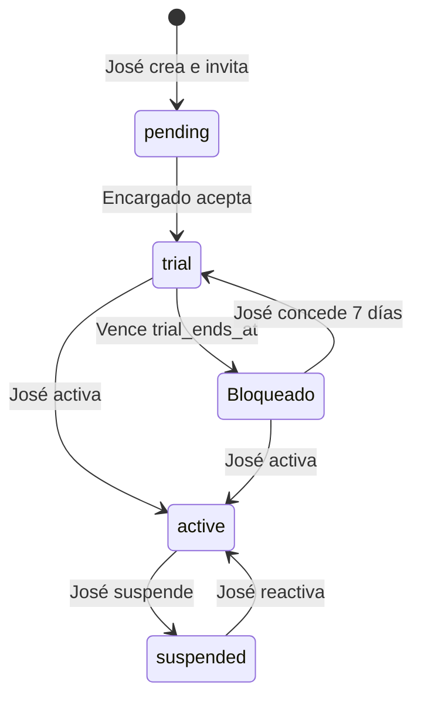

# Contexto

GYM es una plataforma para que José ofrezca pruebas de siete días a varios gimnasios. Una sola base Supabase atiende a todos; los clientes finales del gimnasio no acceden al panel.

## Arquitectura y destino

React + TypeScript + Vite; Supabase Auth para identidad y PostgreSQL/RLS para permisos. El frontend usa únicamente una clave pública. Las operaciones financieras y de plataforma usan funciones SQL transaccionales; no hay claves privilegiadas en el navegador.

Destino único: Supabase GYM, cjmffrhnlsypasnijuhm, us-east-2. Frontend publicado por el usuario en https://gymtuchin.vercel.app. Migraciones canónicas en supabase/migrations; no mantener snapshots SQL alternativos.

## Roles y pruebas

El rol global vive en private.platform_admins. La cuenta confirmada autorizada de José fue asignada expresamente como superadministradora en esta base; la asignación personal no se incluye como semilla en Git. Nuevos usuarios nunca reciben ese rol automáticamente.

José crea un gimnasio con estado pending e invita a un encargado. Al aceptar con su correo confirmado, el gimnasio cambia a trial, el destinatario se convierte en su encargado (owner_id), y empieza una semana de siete períodos de 24 horas. Reemplazar al encargado no reinicia la prueba.

Bloqueado es un estado calculado, no una fila duplicada: el acceso depende de lifecycle y trial_ends_at. El vencimiento se valida en RLS y en escrituras RPC; no necesita cron. El panel comprueba su límite cada 15 segundos. Los datos permanecen y solo José puede reactivar.

El encargado administra sus tarifas, clientes, ventas, finanzas y equipo. Existe un único permiso operativo visible: Operario, que reúne recepción, inventario y consulta de clientes. Registra visitas/clientes, vende, cobra membresías y mantiene productos y máquinas. No archiva, retira o reactiva registros; no configura tarifas del gimnasio, administra colaboradores ni accede a finanzas. Los archivados corresponden al encargado o José. Las ventas cerradas siempre son inmutables.

## Datos y reglas

Tablas: gyms, staff, clients, products, machines, sales, sale_items, memberships, cash_entries y staff_invitations. Privadas: platform_admins y reminder_jobs. Cada entidad operativa incluye gym_id; claves compuestas impiden referencias a otro gimnasio.

COP y America/Bogota. Importes en centavos enteros. Precio diario, precio de membresía y membership_days son configurables por gimnasio. La renovación anticipada conserva días pendientes. Los cambios afectan a ventas nuevas.

Las invitaciones distinguen manager y staff. Solo la plataforma crea invitaciones de encargado. El destinatario se verifica contra auth.users con correo confirmado, nunca metadata editable. invite-staff valida el token, el rol de plataforma o la propiedad del gimnasio y la vigencia antes de enviar correo.

## Acceso y recuperación

Site URL de Supabase: https://gymtuchin.vercel.app. Redirect URLs: https://gymtuchin.vercel.app/**. El conector no permite editar estos ajustes de Auth; se guardan en el dashboard. El usuario confirmó su correo.

El registro y reenvío indican el origen actual. Los enlaces nuevos de recuperación apuntan a /?auth=recovery; los anteriores con setup=1 o type=recovery siguen reconocidos. Se captura el tipo de enlace antes de inicializar el SDK. Un enlace inválido muestra explicación; no se guardan tokens en la documentación.

## Estado y verificaciones

Implementado: plataforma de gimnasios, encargados, control de pruebas, panel operativo, tarifas/vigencias, invitaciones, landing y recuperación. La función invite-staff está desplegada en Supabase y admite el dominio de producción.

Verificado: build, lint y nueve pruebas de lógica; consultas reales de solo lectura para comprobar superadministración, falta de acceso de una cuenta no asignada y alta directa bloqueada. Ver docs/VERIFICACION.md. Las pruebas con escrituras ficticias se retiraron tras el bloqueo de revisión automática; no se crea una base paralela.

Pendiente: confirmar entrega y aceptación de una nueva invitación real; correo SMTP propio antes de ofrecerlo a terceros; worker/programación de recordatorios; comprobación completa de una venta desde navegador con cuenta operaria. No afirmar que se probaron estos recorridos completos.

Avisos Supabase: protección contra contraseñas filtradas desactivada; private.reminder_jobs sin políticas de usuario intencionalmente (solo worker de servicio). No es una auditoría completa.

## Cambios preparados el 29 de octubre de 2026

En el código local: resumen financiero con filtros hoy/semana/mes, gráfica y tabla accesible; acceso visible a Gastos e ingresos; explicación de productos; valor opcional de máquinas e inicio público de demostración con ubicación, horarios y actividades ilustrativos. No hay gestor de publicaciones.

Migración aplicada con autorización explícita: `20261029143256_operation_summary_assets_visits.sql`. Añade `machines.asset_value` nullable en centavos, conservando RLS de encargado/inventario; `finance_summary` solo para encargado/plataforma con gimnasio habilitado; y control de visitas en `private.open_sale`. Bloquea la fila del cliente para serializar recepciones concurrentes y devuelve la cuenta abierta existente o la visita del día en Bogotá, sin duplicar el pase. También continúa cuentas abiertas de días anteriores. Las cuentas cerradas se consultan sin editar. La agregación financiera usa todas las filas del período y no depende de la paginación del panel. Activos excluyen máquinas retiradas y no se mezclan con caja.

La migración se aplicó tras la autorización explícita del usuario. Se verificó por lectura que existe asset_value y se ejecutó finance_summary para día/semana/mes con identidad del encargado dentro de una transacción de solo lectura: los totales coinciden con ventas cerradas y el acceso sin identidad es rechazado. Tras aprobar el acceso del equipo en Vercel, frontend publicado en producción: https://gymtuchin.vercel.app, deployment dpl_AwTMJbUyft4MgSqBQnF5qpwa3Y86, estado READY y dominio asignado. Se desplegaron los archivos locales de la aplicación y su lockfile, sin .env.local; los cambios aún no están confirmados en Git. No se crearon bases ni registros de prueba. Recuperación: restaurar `private.open_sale` anterior; antes de retirar la columna nueva, exportar cualquier valoración que llegue a registrarse.

Diagnóstico de invitaciones: los logs de Auth mostraron dos respuestas 429 `over_email_send_rate_limit` al enviar la invitación pendiente. El proveedor de correo de prueba alcanzó el límite; no es evidencia de entrega. El código local de invite-staff ahora distingue límite de envío y destinatario no autorizado; este cambio está desplegado en invite-staff versión 4, que conserva su validación interna de identidad y permisos. Falta configurar SMTP propio y verificar una entrega real autorizada. No guardar destinatarios ni tokens en esta documentación.

## Alta manual sin correo

Solicitada por el usuario para trabajar sin SMTP. Se reutilizan staff_invitations como asignaciones pendientes, sin tablas ni bases adicionales. La nueva Edge Function create-manual-user verifica la sesión con Auth, consulta la asignación y gimnasio con el JWT del solicitante (RLS), y comprueba propiedad, rol, vigencia y acceso activo. Solo la plataforma crea encargados; encargado/plataforma crean colaboradores operativos. El endpoint solo acepta ID de asignación y contraseña; correo y permisos proceden de PostgreSQL.

Supabase Auth Admin crea la cuenta nueva desde el servidor con correo administrativamente confirmado y contraseña inicial, sin enviar correo ni cambiar la sesión del administrador. No es una verificación de propiedad del buzón. Por ello app_metadata.manual_invitation_id, controlado exclusivamente por el servidor, limita la aceptación SQL a esa asignación exacta. Así, crear una cuenta para un correo ajeno no permite tomar otras invitaciones del mismo correo en otros gimnasios. Nunca se asigna superadministración ni se usa metadata editable para permisos. No se actualiza ni confirma una cuenta existente, ni se restablece su contraseña.

La migración manual_account_scope endurece private.accept_staff_invitations para las nuevas identidades manuales; las cuentas verificadas por correo mantienen su flujo. El primer ingreso acepta la asignación e inicia los siete días si el gimnasio estaba pending; no reinicia pruebas anteriores. La persona debe entrar antes de vencer la asignación (siete días desde su creación). Si una identidad manual necesita otro gimnasio o venció su asignación antes de entrar, requiere gestión de la plataforma; no se amplía su alcance automáticamente. Recuperación por correo sigue dependiendo de SMTP. No guardar ni registrar contraseñas iniciales en documentos, logs ni almacenamiento del navegador.

Estado: migración `20261029151740_manual_account_scope.sql` aplicada y create-manual-user v1 ACTIVE. Se comprobaron por lectura el filtro de asignación en metadata de servidor y la ausencia de ejecución anónima/autoasignación de plataforma. Frontend publicado en producción: deployment `dpl_2gunMK73q8UUR6Lno4nVjX7PTUfM` READY con alias gymtuchin.vercel.app. No se crearon cuentas reales para verificar.

## Operario unificado y ajuste de interfaz

La migración `20261029154556_unified_operator_access.sql` está aplicada. `private.operator_role_matches` considera equivalentes reception, inventory e instructor para permisos operativos; `private.member_of` lo aplica en PostgreSQL. Las políticas y RPC que exigen owner siguen restringidos, así como las guardas de archivado/retiro y la vigencia de la prueba. Los usuarios con roles heredados reciben el mismo acceso combinado sin reescribir sus filas. La interfaz normaliza el rol efectivo y usa reception para altas nuevas. No se solicita, consulta ni muestra tarifa por hora en Equipo; se conservan las columnas históricas y su valor por defecto para evitar pérdida de datos.

Refinamiento visual con Impeccable: se conserva el sistema verde/marfil, se separan campos/ayudas/acciones/resultados, los botones de cancelar quedan dentro de su formulario y las tablas de equipo se apilan en móvil con etiquetas por campo. Invitación por correo queda como alternativa desplegable a la creación manual. No se encontró una skill instalada llamada taster.

Publicación del operario unificado y ajustes visuales: deployment dpl_5ZSNXWN1raM68N9Q6ePQdxjp9XZh READY en producción, alias gymtuchin.vercel.app.

Refinamiento de acceso y navegación: Auth se separó en src/Auth.tsx, conservando los mismos métodos Supabase y destinos de confirmación/recuperación. Acceso principal, recuperación y ayuda de primer acceso tienen jerarquía y espacios propios; se retiró el panel promocional del login. La navegación agrupa inventario y administración; en móvil/tableta se pliega bajo Menú. No hay cambios de esquema ni reglas de negocio en este bloque. Taste Skill e Impeccable se aplicaron como refinamiento de componentes del sistema existente, sin sortear una identidad nueva.

Acceso y navegación publicados: deployment dpl_91Kcqn6vqFKkq9PJuPk1cfq8Jywv READY, con alias gymtuchin.vercel.app. Verificación de interacción sobre el build local y APIs simuladas; no se inició sesión ni se enviaron correos reales en producción.

Formularios de alta: DataForm admite resetOnSuccess. Clientes, productos, máquinas, ingresos, membresías, movimientos y creación de accesos limpian los datos introducidos tras completar el guardado; restablecen sus valores iniciales (p. ej., cantidad 1). Configuración y edición conservan su comportamiento. Los errores no reinician el formulario; las contraseñas mantienen su limpieza de seguridad previa. Build/lint correctos. Se incluye en la entrega por Git solicitada junto a membresías y compras adicionales.

## Ingresos cubiertos y compras adicionales

Migraciones aplicadas: `20261029162629_membership_included_entry.sql` y `20261029163117_product_only_purchases.sql`. La membresía cubre el pase si starts_on <= hoy Bogotá < expires_on. PostgreSQL calcula la cobertura aunque el cliente intente cobrar un pase: agrega un concepto de ingreso incluido a precio cero y permite finalizar sin importe por cobrar. En una cuenta abierta de hoy, sustituye únicamente el pase diario automático por ese concepto; las cuentas cerradas y las pendientes de días anteriores se conservan. No descuenta días de una bolsa de usos ni cambia la fecha de vencimiento. Los productos conservan su precio.

Ingresos y ventas usa EntryClientPicker: búsqueda por nombre sobre todos los clientes activos del gimnasio, espera de 250 ms, máximo 20 coincidencias ordenadas y sin límite global de 100 clientes. La membresía del cliente seleccionado se consulta específicamente, incluyendo su fecha de inicio.

Las ventas admiten kind=products. open_product_sale valida rol, gimnasio y cliente en PostgreSQL y abre/reutiliza una compra de productos pendiente para la persona, con clave idempotente y bloqueo de cliente. No registra visita ni pase, no reabre la cuenta pagada ni renueva membresía. La interfaz ofrece Solo productos y Nueva compra para este cliente cuando consulta una cuenta cerrada. Una compra posterior genera otro comprobante independiente; se pagan y descuentan existencias al cerrar con el flujo transaccional existente.

Entrega solicitada mediante commit/push a main; no se solicita un despliegue adicional por la API de Vercel. Comprobar el despliegue generado por Git tras el push.
